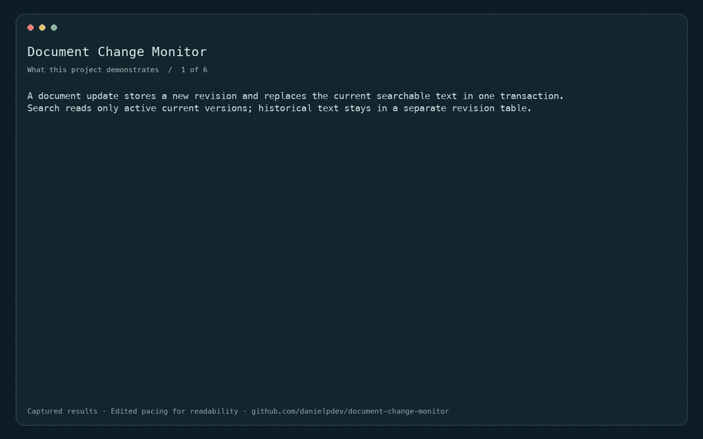
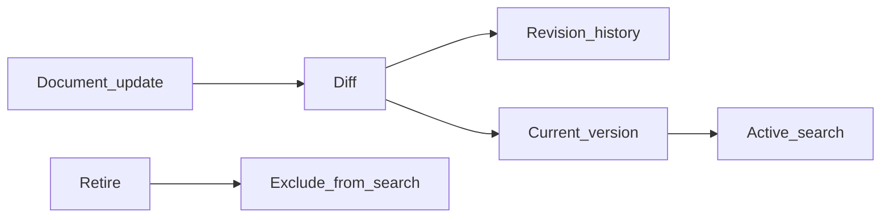

# Document Change Monitor

Versioned document diffs and replacement-safe search indexing.

[](https://github.com/danielpdev/document-change-monitor/actions/workflows/ci.yml)

**Role focus:** RAG Operations / Backend. **Status:** working local portfolio implementation, with synthetic data.

## Demo



Edited replay of captured CLI outputs in deterministic fixture mode. This is not live model inference. [Full recording](docs/demo.mp4). Rebuild with `./scripts/render_gif.sh` (FFmpeg required).

## The engineering decision

A document update stores a new revision and replaces the current searchable text in one transaction. Search reads only active current versions; historical text stays in a separate revision table.



## Run locally

Requirements: Python 3.12, [uv](https://docs.astral.sh/uv/getting-started/installation/) and Make.

```bash
git clone https://github.com/danielpdev/document-change-monitor.git
cd document-change-monitor
make setup
make demo
make test
make eval
```

`make demo` uses an isolated temporary database where relevant, so it is safe to repeat. `make eval` writes a timestamped report to `reports/evaluation-fixture.json`. Fixture mode is deterministic and does not represent model inference. There is no recurring hosting or API subscription cost.

`make serve` opens the local API on `http://127.0.0.1:8116/docs`.

[Watch the recorded demo](docs/demo.mp4) · [Reproduce the walkthrough](docs/DEMO.md)

## Verification and evidence

Unchanged content does not create revisions, old terms disappear after replacement, retired documents disappear from search and history remains available.

- [Evaluation report](reports/evaluation-fixture.json) — measured during an actual run; inspect the mode and dataset size.
- [Development and authorship](docs/DEVELOPMENT.md).
- [Romanian interview preparation](docs/INTERVIEW_RO.md).
- [Design notes](docs/DESIGN.md).
- [Demo walkthrough](docs/DEMO.md).

CI uses standard GitHub-hosted runners and deterministic tests without downloading LLM weights. The lockfiles record exact package versions. Local-model results, when present, live in `reports/evaluation-local.json`; hardware/model identities are in `reports/environment.json`.

## Limits and next iteration

The index is an on-read lexical scan for a tiny corpus, not a vector database. Full documents are kept in memory; large-source streaming is not implemented.

Next: Add an asynchronous embedding index with version fences and content-source polling.

The local demonstration does not include production authentication, secret management or operational service guarantees. Bind it to localhost and use synthetic data. These projects demonstrate engineering decisions; they do not claim real customers, paid production deployments or guaranteed interviews.

## Project ownership

Implemented with Codex assistance for Daniel Popa. The owner should review the code, run it, make an independent change and rehearse the tradeoffs before presenting it at interview. That human understanding check is pending and cannot be verified automatically. See [development notes](docs/DEVELOPMENT.md).

MIT for original source; dependencies/models retain their own licenses. See [third-party notices](THIRD_PARTY.md).
